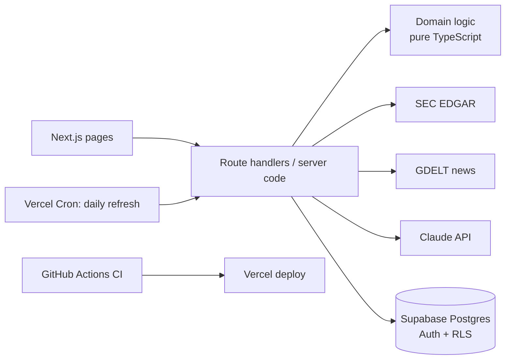

# PRD — FinLens: Source-Traceable Financials for US Public Companies

Draft v0.2 · Nov 23, 2026 · Arianna Ge (solo)

## 1. Overview

FinLens is a web app that gives self-directed investors a one-page view of a US public company: its key financial numbers from SEC filings, how it ranks against its industry peers, and a short AI brief of recent events. Every number links to the exact filing, period and line item it came from, and every AI claim cites a source that the app checks before showing it. FinLens explains companies; it never predicts prices or gives investment advice.

## 2. Problem

Investors who read fundamentals themselves get their numbers from long filings and from finance sites that don't say where a figure came from. This breaks down in predictable ways:

- **Numbers can't be traced.** A free site shows "revenue: $391B" without saying which filing, period or line item it came from, so a typo or a restated figure is impossible to spot.
- **Some quarters were never reported.** Companies don't file a fourth quarter on its own; sites quietly compute it and present it as if it were reported.
- **Companies label the same thing differently.** One company tags revenue as `Revenues`, another as `RevenueFromContractWithCustomerExcludingAssessedTax`, so naive comparisons mix up metrics.
- **Peer comparison is manual.** Knowing whether a 38% gross margin is good means collecting the same metric for the whole industry by hand.
- **News and filings are scattered.** Material events are in 8-K filings, headlines are on many news sites, and nothing connects them to the numbers.
- **AI summaries can't be checked.** General chatbots summarize news confidently, but their claims and figures come without sources.

Assumptions to validate with 3+ Mom Test interviews in Sprint 1 (results go in `docs/research/`):

- **A1:** users check a number against its source at least occasionally.
- **A2:** users compare a company with its peers today, and do it manually.
- **A3:** users distrust AI summaries that carry no sources.

## 3. Target users and roles

**Personas**

- **Self-directed retail investors** who pick stocks themselves, read earnings reports and want to check a number before they buy or hold.
- **Students in investing clubs** who prepare stock pitches and need comparable numbers for a company and its peers.

**Roles**

| Role | Who | Can do |
| --- | --- | --- |
| Visitor | Anyone, no account | Search; company page; source drill-down; peer ranking; cached AI brief |
| Investor | A signed-in user | Everything a visitor can, plus a private watchlist with change flags |
| Admin | The site operator | Review data-quality flags and unresolved concepts; set concept overrides; trigger a data refresh |

Permissions are enforced on the server (route checks and database row-level security), not only by hiding buttons. A watchlist is visible only to its owner.

## 4. Goals and success metrics

**Goal:** an investor can see a company's key numbers, check where each one came from and how it compares with its peers, and catch up on recent events through claims that are all checked against sources, without opening a single filing.

| Metric | Target | How we measure it |
| --- | --- | --- |
| Reported numbers that match the value in their source filing | 100% for the curated companies | Tests against saved SEC companyfacts excerpts (Apple, JPMorgan Chase) |
| Numbers on the company page with a working source link or formula (F3) | 100% | Playwright E2E test opens the drill-down for every metric of 3 companies |
| AI brief claims whose cited ids and numbers pass the checker (F5) | ≥ 95% on the eval set; 100% of failing claims hidden | Eval with ~20 saved company bundles (Sprint 3) |
| New users who find a company and open a number's source without help | ≥ 4 of 5, each in ≤ 2 min | Usability test with 5 target users |
| Company page load | Cached < 1 s; first fetch of a company < 5 s | Playwright timing in CI and Vercel analytics |
| Line coverage of `src/lib/domain` | ≥ 80% | `npm run test:coverage` in CI |
| Accessibility of the main pages | Lighthouse ≥ 90, no critical axe violations | Lighthouse and axe checks in CI |

## 5. User stories and acceptance criteria

Priorities use MoSCoW. Acceptance-criteria ids (e.g. `F2-2`) start the matching test names and appear in commit messages.

- **Must:** F1 Find a company · F2 Key metrics · F3 See where a number came from · F5 Recent-developments brief · F6 Watchlist
- **Should:** F4 Compare with peers
- **Could:** F7 Fix data quality

### F1 — Find a company (Must)

> As an investor, I want to type a ticker or a company name and land on that company's page, so that I don't need to know SEC ids or browse EDGAR.

- **F1-1** Searching by ticker is case-insensitive and resolves to a CIK via the SEC ticker file.
- **F1-2** Searching by company name returns up to 10 prefix matches.
- **F1-3** An unknown ticker shows an empty state with suggestions, not an error page.

### F2 — Key metrics (Must)

> As an investor, I want a company's key numbers for the last five fiscal years and four quarters, measured the same way for every company, so that I can see the trend without reading the filings.

Canonical metrics: revenue, gross profit, gross margin, operating income, operating margin, net income, net margin, operating cash flow, free cash flow, cash, total debt, debt-to-equity.

- **F2-1 Concept resolution.** Each canonical metric has an ordered list of us-gaap concepts (e.g. revenue: `Revenues`, `RevenueFromContractWithCustomerExcludingAssessedTax`, `SalesRevenueNet`). For each period, the first concept with a value wins, and the concept used is recorded. An admin override for that company and metric wins over the list.
- **F2-2 Derived Q4.** When a fiscal year value and its 9-month year-to-date value both exist but Q4 is not reported, Q4 = FY − 9M YTD, marked `derived`.
- **F2-3 Fiscal periods.** Periods are labeled by the company's fiscal year and quarter, not the calendar. A fact's fiscal period comes from its own `start`/`end` dates measured against the company's fiscal year-end, not from the companyfacts `fy`/`fp` fields: those describe the filing, so comparative facts carry the filing's year.
- **F2-4 Missing inputs.** A metric whose inputs are missing is `null` with a reason (`no_data`, `missing_input:<name>`), never `0`. A ratio whose denominator is 0 is `null` with `zero_denominator:<name>`, never `Infinity`.
- **F2-5 Restatements.** When the same period appears in several filings, the value from the latest filing is shown; earlier values stay available as history. Only 10-K, 10-Q and 8-K filings, their amendments (10-K/A, 10-Q/A, 8-K/A) and 10-KT transition reports count; other forms, such as a DEF 14A proxy statement that repeats rounded figures, are ignored.
- **F2-6 Consistency check.** If gross profit and cost of revenue are both reported, |revenue − cost of revenue − gross profit| must be within 0.5% of revenue; otherwise the period gets a data-quality flag.

### F3 — See where a number came from (Must)

> As an investor who doesn't trust numbers blindly, I want to see exactly which filing, period and line item each number came from, so that I can check it myself.

- **F3-1** Every reported number shows form type, fiscal period, filing date, us-gaap concept, accession number and a link to the filing on sec.gov.
- **F3-2** Every derived number (margins, ratios, derived Q4) shows its formula and links to each input's source.

### F4 — Compare with peers (Should)

> As an investor, I want to see how a company's margins and ratios rank in its industry, so that I know whether a number is good or bad for that kind of business.

- **F4-1** Peers are companies with the same 4-digit SIC code; with fewer than 5 peers, fall back to the 2-digit SIC group. The peer count is always shown.
- **F4-2** For each margin and ratio in the latest fiscal year, show the company's percentile among peers (rank-based, ties share the average rank).
- **F4-3** Peers without a value for that metric are excluded from that metric only.

### F5 — Recent-developments brief (Must)

> As an investor, I want a short summary of what happened to a company recently, with a source for every claim, so that I can catch up quickly and still check everything.

Input bundle: the company's 8-K filings from the last 90 days (item codes, filing date, short excerpt), news headlines from the last 30 days, and the F2 metrics. Every item in the bundle has a stable source id (`m:gross_margin:FY2025`, `f:<accession>`, `n:<id>`).

Output (structured JSON): 3–5 `events` `{title, sentiment: positive|negative|neutral, summary, related_metric?, source_ids[]}` and up to 3 `watch_items` `{text, source_ids[]}`.

- **F5-1** Every event and watch item cites at least one source id, and every cited id exists in the input bundle.
- **F5-2 Citation checker.** Every number in an event summary must match (after rounding to the shown precision) a number in one of its cited sources. Claims that fail are marked `unverified` and hidden by default.
- **F5-3** A brief is generated at most once per company per day; later visits read the cached brief.
- **F5-4** With no 8-Ks and no news in range, no model call is made and the page says so.
- **F5-5** The brief always shows the disclaimer "For informational purposes only. Not investment advice."
- **F5-6 8-K categories.** 8-K item codes map to event categories before the model sees them: 2.02 earnings; 5.02 leadership change; 1.01/1.02 material agreement; 2.01 acquisition or disposition; 2.05/2.06 restructuring or impairment; 4.01/4.02 auditor change or non-reliance (high severity); 1.05 cybersecurity incident (high severity). Items 7.01, 8.01 and 9.01 alone are "other".

### F6 — Watchlist (Must)

> As a signed-in investor, I want a private watchlist that tells me what changed since my last visit, so that I don't have to check every company by hand.

- **F6-1** Signed-in users can add and remove companies; the list is private (row-level security: users read and write only their own rows).
- **F6-2** Each watchlist row shows flags since the user's last visit: a new 10-K, 10-Q or 8-K filed, or a margin that moved more than 3 percentage points.

### F7 — Fix data quality (Could)

> As the site admin, I want to see data-quality problems and fix how a metric is mapped for a company, so that wrong numbers don't reach users.

- **F7-1** Admins see the list of data-quality flags (F2-6) and unresolved concepts.
- **F7-2** Admins can set a concept override for a company and metric (used by F2-1).

## 6. UI/UX requirements

- **Main screens:** home with search; search results (with the F1-3 empty state); company page (metrics by year and quarter, flags, peer percentiles, AI brief); source drill-down panel; sign in and sign up; watchlist; admin data-quality page.
- **The company page is the focus:** company name, ticker, CIK and the latest fiscal year's numbers are visible without scrolling.
- **Numbers are clear:** units are shown (USD millions), periods use fiscal labels such as `FY2025` and `Q2 FY2025`, derived values say "derived", and a missing value shows "—" with its reason, never `0`.
- **Trust is visible:** every number opens its source; the brief always shows the disclaimer; headlines always show "News via the GDELT Project" with a link.
- **Mobile first:** one column on phones; wide tables scroll inside their own container instead of the page.
- **Accessible:** WCAG 2.1 AA, full keyboard use, visible focus, a label on every form field, contrast at least 4.5:1, flags that use an icon and text rather than color alone, and a table view for every chart. Search works without JavaScript.

## 7. Technical requirements

| Area | Requirement |
| --- | --- |
| Stack | Next.js 16 (App Router, Cache Components) + TypeScript (strict) + Tailwind CSS 4; Zod for validation; Supabase (PostgreSQL, Auth); deployed on Vercel. |
| Architecture | Pure business logic in `src/lib/domain` (no I/O, no clock); thin adapters for SEC, GDELT and Claude in `src/lib/sources`; every external call runs on the server; pages load data per request inside `<Suspense>`. |
| Data | SEC responses cached with `"use cache"` + `cacheLife('days')`, later persisted by a daily Vercel Cron job. Draft tables: `companies`, `facts_cache`, `metrics`, `filings`, `news_items`, `briefs`, `watchlists`, `concept_overrides`, `data_issues`. Schema changes only through migration files. |
| Auth | Supabase Auth with email and password; row-level security on every user-owned table. |
| Security | Secrets only in environment variables (`.env.example` lists names only); `SEC_USER_AGENT` and the Anthropic key are server-only; Zod validation on every route input; rate limiting on API routes; `npm audit` and secret scanning in CI. |
| Testing | Strict TDD for `src/lib/domain`: a failing test is committed before each implementation (red → green → refactor). Fixtures are small excerpts of real SEC data. Line coverage ≥ 80% (`npm run test:coverage`); adapters are mocked in unit tests; Playwright E2E for the core flow (search → company page → drill-down → brief). |
| CI/CD | GitHub Actions on every PR: lint → typecheck → tests → build → E2E, plus a security job. A preview deploy for every PR; production deploys from `main`. |

### 7.1 Data sources

- **SEC EDGAR APIs** (public data, no API key; EDGAR content is "free to access and reuse", so cite the SEC as the source). Fair-access rules: every request sends a descriptive `User-Agent` with a contact email, at most 10 requests per second, all from the server and cached. The official docs say `data.sec.gov` does not support CORS.
  - `https://www.sec.gov/files/company_tickers.json` — ticker → CIK (served from `www.sec.gov`, not `data.sec.gov`; same `User-Agent` rules).
  - `data.sec.gov/submissions/CIK##########.json` — name, SIC code, recent filings (form, date, accession number, primary document, 8-K items).
  - `data.sec.gov/api/xbrl/companyfacts/CIK##########.json` — every XBRL fact with value, period, `fy`, `fp`, form, filing date and accession number.
  - `data.sec.gov/api/xbrl/frames/...` — one concept across all companies for one period (peers). `CY2025` = annual, `CY2025Q1` = one quarter's duration, `CY2025Q1I` = a point-in-time (balance-sheet) value at quarter end.
  - Filing link: `https://www.sec.gov/Archives/edgar/data/{CIK}/{accession without dashes}/{primaryDocument}`.
- **News headlines — GDELT DOC 2.0 API.** Chosen because its terms allow public, unrestricted use and redistribution ("academic, commercial, or governmental"), which a deployed app needs.
  - Every page that shows GDELT headlines shows "News via the GDELT Project" with a link.
  - There is no ticker filter: query the exact company name as a phrase with `sourcelang:english`, and drop results whose title does not contain the name.
  - It allows about one request per 5 seconds and returns HTTP 429 when busy, so a scheduled job fetches news for curated and watchlisted companies (≥ 5 s apart) and caches it; page views never call GDELT.
  - Store the headline, publisher domain, URL and publish time only; never article bodies.
- **Rejected news APIs** (checked 2026-11-22): the NewsAPI.org free plan is "development and testing … only"; Alpha Vantage news is premium-only; the Finnhub, Marketaux and Massive free tiers are for personal use, and Finnhub forbids redistributing "derived results". Finnhub (ticker filter, 1 year of history) can be added later only with written permission from Finnhub.
- **Terms:** a 10-K, 10-Q and 8-K are the annual report, the quarterly report and a current report on a material event. XBRL tags make filings machine-readable; a us-gaap concept is one tag, such as `Revenues`. A CIK is the SEC's company id, an accession number identifies one filing, and an SIC code is the company's industry code.

### 7.2 AI brief design (F5)

- **Model:** `claude-opus-5-5` by default, configurable through the `ANTHROPIC_MODEL` environment variable; `effort: "low"` to start, tuned with the eval.
- **Structured outputs:** request JSON that matches a schema (`output_config.format`, validated with Zod via the SDK's `messages.parse()`). The API's built-in Citations feature is not used: it cannot be combined with structured outputs, and FinLens needs its own source ids anyway.
- **Grounding:** the prompt lists the bundle items with their ids and says to cite ids only; the deterministic checker (F5-1, F5-2) runs on every response before it is saved.
- **Cost controls:** one brief per company per day (F5-3); a global daily cap on model calls; `max_tokens` set; a spend limit in the Anthropic Console; the key stored only in Vercel and Supabase environment variables.
- **Failure handling:** a `stop_reason` of `refusal` or `max_tokens` saves no brief, and the page shows the previous brief or a notice.
- **Eval (Sprint 3):** ~20 saved company bundles; measure the share of cited sources that exist and the share of claims that pass the checker.

### 7.3 Architecture diagram

## 8. Out of scope (v1)

- Price predictions, buy/sell signals or any investment advice
- Real-time stock quotes and price charts
- Portfolio tracking with positions, cost basis or returns
- Companies that don't file XBRL financial statements with the SEC (for example most non-US companies)
- Private companies or uploading your own financial statements (a possible later idea: holding companies tracking their subsidiaries)
- Full news articles (headlines and links only)
- Paid data feeds
- Email or push notifications (watchlist flags are shown in the app)
- Sign-in with Google or other providers
- Native mobile apps (the responsive web app covers phones)

## 9. Milestones, risks and open questions

**Milestones**

| Sprint | Dates | Scope |
| --- | --- | --- |
| 1 | Nov 23 – Dec 1 | F1, F2, F3 for ~20 curated companies; interviews; CI |
| 2 | Dec 2 – Dec 8 | F5 (brief + checker), F6 (auth + watchlist) |
| 3 | Dec 9 – Dec 15 | F4, F7 if time; security audit; eval; deploy polish; demo |

Final submission: Finals Week (Dec 14–20; exact date on Canvas).

**Risks**

| Risk | Mitigation |
| --- | --- |
| Companies tag the same metric with different XBRL concepts | Ordered fallback lists, admin overrides, start with curated companies |
| SEC fair-access limits | Server-side cache, `User-Agent`, backoff on 429 and 403 |
| LLM cost or made-up claims | Daily cache and caps; deterministic citation checker |
| News licensing | GDELT (terms allow redistribution) with attribution; headlines and links only |
| GDELT throttling, name collisions | Scheduled fetch spaced ≥ 5 s, cache; exact-phrase query + title filter; 8-Ks still give a brief when news is missing |
| Solo scope | MoSCoW; F4 and F7 can slip without breaking the core flow |

**Open questions**

- Model for F5: keep `claude-opus-5-5`, or switch `ANTHROPIC_MODEL` to a cheaper model after the eval shows whether quality holds.
- Which ~20 companies form the curated starting set (spread across 4–5 industries).
